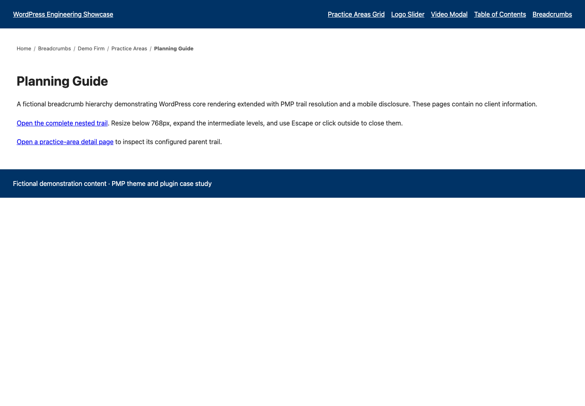
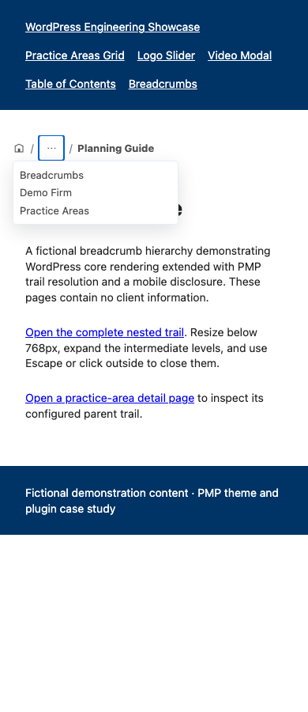

# Breadcrumbs

[Back to the feature index](../../README.md#features)

**Type:** Extension of WordPress core · **Demo availability:** PMP integration in after only · [Open the nested demo](http://localhost:8890/breadcrumbs/demo-firm/practice-areas/planning-guide/)

Developed by Wilbert Caba for the PMP theme and plugin. WordPress contributors provide `core/breadcrumbs`, its editor controls, and base rendering. This work extends that core block with PMP-aware trail data, settings, mobile presentation, and SEO-plugin adapters. It is not presented as a 10up Breadcrumbs feature or an independently authored core block.

## Business need

A content model can have useful navigational parents that differ from its URLs or WordPress archives. Practice areas, for example, need a selectable parent page, including that page’s ancestors. Readers also need a compact way to navigate a deep trail on small screens, without losing the intermediate links.

## My contribution

- Separated trail resolution in the plugin from rendering in the theme.
- Added per-site enablement, a Home label, and configurable parent pages for public PMP post types.
- Resolved published page ancestors, configured-parent ancestors, and canonical taxonomy trails with deterministic selection.
- Integrated those trails with the core block while respecting its Home/current-item controls.
- Added an icon-only Home link and expandable intermediate levels below 768px, with keyboard dismissal and focus handling.
- Added adapters for Yoast and SmartCrawl breadcrumb arrays, preserving the provider’s current-page/pagination handling rather than emitting competing JSON-LD.
- Removed registered shortcodes from labels without executing them.

The source revisions, retained files, and adaptations are recorded in the [provenance manifest](../provenance.json). No private repository access is required to run the demo.

## Runtime prerequisite and the before environment

Both showcase sites are pinned to **WordPress 7.0.9**. Core introduced the Breadcrumbs block in WordPress 7.0; see the [official field guide](https://make.wordpress.org/core/2026/05/14/wordpress-7-0-field-guide/). Using the same core release keeps the comparison focused on the extracted theme/plugin code.

The before environment retains its original theme and plugin source from `.showcase/before/`. It has the core block supplied by WordPress, but no PMP breadcrumb resolver, settings, template integration, or demo pages. The historical Grid frontend/editor and the complete existing browser suite were verified after the core upgrade, before this feature was added.

For an existing checkout, update both installed sites without reseeding:

```sh
SHOWCASE_RUNTIME=php npm run demo:update
```

For Docker, omit `SHOWCASE_RUNTIME=php`. The command refreshes the configured WordPress sources and runs database upgrades in both environments. It does not reset their content. Fresh setup uses the pinned release automatically. Continue using `demo:start` for daily use.

## Try the examples

1. Open the [nested page](http://localhost:8890/breadcrumbs/demo-firm/practice-areas/planning-guide/). Its trail is **Home / Breadcrumbs / Demo Firm / Practice Areas / Planning Guide**. Follow each ancestor link to inspect its destination.
2. From the [feature landing page](http://localhost:8890/breadcrumbs/), follow **Open a practice-area detail page**. Its configured parent contributes **Breadcrumbs / Demo Firm / Practice Areas** before the current practice area.
3. Resize below 768px. Activate the ellipsis with Enter or Space to reveal the intermediate links. Escape closes the disclosure and returns focus to its button. Clicking outside, moving focus out, or returning to desktop also closes it.
4. Open the Grid home page. The breadcrumb template part is omitted entirely on the front page.

All hierarchy pages and names are fictional. The existing practice-area records are reused without changing their content or parent relationships.

### Add this feature to an existing installation

After updating WordPress:

```sh
npm --prefix themes/pmp-theme ci
npm run build
SHOWCASE_RUNTIME=php npm run demo:seed:breadcrumbs
```

For Docker, use `npm run demo:seed:breadcrumbs`. For two disposable Local sites, use WordPress 7.0.9 in both; in the after site’s Site Shell run `wp eval-file /absolute/path/to/wordpress-engineering-showcase/scripts/seed-breadcrumbs.php`.

The feature-only seed creates or restores four owned pages, enables breadcrumbs, sets the Home label to Home, and selects the fictional Practice Areas page as the practice-area parent. It overwrites those demo settings/page edits when repeated. It preserves other feature records, home-page settings, and unrelated breadcrumb option keys. Full setup and seeding also include this feature in after only.

## Settings and editor review

Open **Settings → Breadcrumbs** in the after dashboard:

| Setting | Behavior |
| --- | --- |
| Enable breadcrumbs | Master switch. When off, the block and its empty template band are omitted. |
| Home label | Text used for Home by the visible trail and SEO adapters. |
| Parent pages → Practice Area | Adds that page and its published ancestors before a practice-area detail. None leaves the practice area’s own hierarchy. |

Settings require `manage_options`; WordPress’s settings form supplies the nonce and capability checks. Parent selectors are generated from the public PMP post types present in this focused extraction.

The shared Breadcrumbs template part sits above `main` in the after template. Edit it through the Site Editor to change core controls such as separator, Home/current-item visibility, colors, spacing, and typography. A template saved in the Site Editor overrides the theme file; add or remove its template-part reference there if needed. The core block can also be inserted into content; doing so in a template that already includes it produces a second trail.

Save and reload before reviewing the frontend. The core editor provides its own context-based preview; use the actual singular frontend to review PMP-specific configured-parent resolution.

## Data flow and tradeoffs

The plugin’s `Resolver` reads `pmp_breadcrumbs_options` and returns the intermediate crumbs. The theme replaces core’s item data on supported singular requests, lets core escape/render the items, then regroups its flat list into Home, intermediate levels, and current item. Desktop displays the levels inline. Mobile retains those links in the DOM and reveals them in a dropdown. Home’s hidden text keeps the icon link named for assistive technology.

The resolver follows content hierarchy rather than splitting the URL. It skips unpublished ancestors and uses the deepest canonical term, with a stable term-ID tie-break. Theme/plugin compatibility is guarded by `TRAIL_SCHEMA_VERSION`; without the matching resolver the theme suppresses the block instead of showing an unaware fallback.

`SeoBreadcrumbs` filters provider arrays; it emits no JSON-LD itself. **No SEO plugin is bundled in this demo.** Adapter tests use representative Yoast/SmartCrawl arrays, not live plugin installations or schema-output verification. The original optional integrations with Shadow Terms, translated objects, and Practice Area topic hubs remain guarded code paths; those systems are not provisioned by this showcase.

The mobile disclosure requires JavaScript. Desktop breadcrumb links render on the server. Core output is restructured only when it matches the expected shape; otherwise it is returned unchanged. The source does not include RTL-specific styling. These boundaries are part of the review, rather than claims of exhaustive third-party compatibility.

## Showcase adaptations

- Explicitly load the focused modules and breadcrumb-label helper instead of importing the private application bootstrap.
- Guard the optional Practice Area Types class because its topic-hub implementation is not extracted here.
- Add a small frontend entry point and include the two breadcrumb stylesheets and button-reset utility.
- Associate the settings checkbox with its label, reject non-array payloads, and retain only known scalar settings before sanitizing them.
- Add the fictional hierarchy, scoped seed, navigation, documentation, and verification.

These adaptations are distinguished from the original feature in provenance. No original private Git history is imported.

| Area | Code entry point |
| --- | --- |
| Trail resolution | [Resolver.php](../../mu-plugins/pmp-plugin/includes/classes/Breadcrumbs/Resolver.php) |
| Site settings | [Breadcrumbs.php](../../mu-plugins/pmp-plugin/includes/classes/SettingsPage/Breadcrumbs.php) |
| Core block integration and mobile markup | [BreadcrumbsBlock.php](../../themes/pmp-theme/includes/classes/Block/BreadcrumbsBlock.php) |
| Mobile disclosure and dragging | [breadcrumbs.js](../../themes/pmp-theme/assets/js/frontend/components/breadcrumbs.js) |
| SEO adapters | [SeoBreadcrumbs.php](../../themes/pmp-theme/includes/classes/Integration/SeoBreadcrumbs.php) |
| Shared template part | [breadcrumbs.html](../../themes/pmp-theme/parts/breadcrumbs.html) |
| Demo content | [seed-breadcrumbs.php](../../scripts/seed-breadcrumbs.php) |

## Screenshots





## Verification

[WordPress checks](../../tests/breadcrumbs-integration.php) cover resolver/rendered-link agreement, published hierarchy, core Home/current controls, enablement, empty-band removal, settings sanitization, shortcode handling, and SEO adapter contracts. [Browser checks](../../tests/browser/breadcrumbs.spec.mjs) cover local destinations, desktop/mobile layout, keyboard behavior, settings persistence, configured parents, front-page suppression, and core editor saves/reloads.

Use `SHOWCASE_RUNTIME=php npm run demo:check` for integration checks, or omit the prefix for Docker. With both sites running, use `npm run test:browser -- --grep 'breadcrumbs:'`. See [verification](../verification.md) for the actual tested runtime and remaining Docker/Local-app limits.
