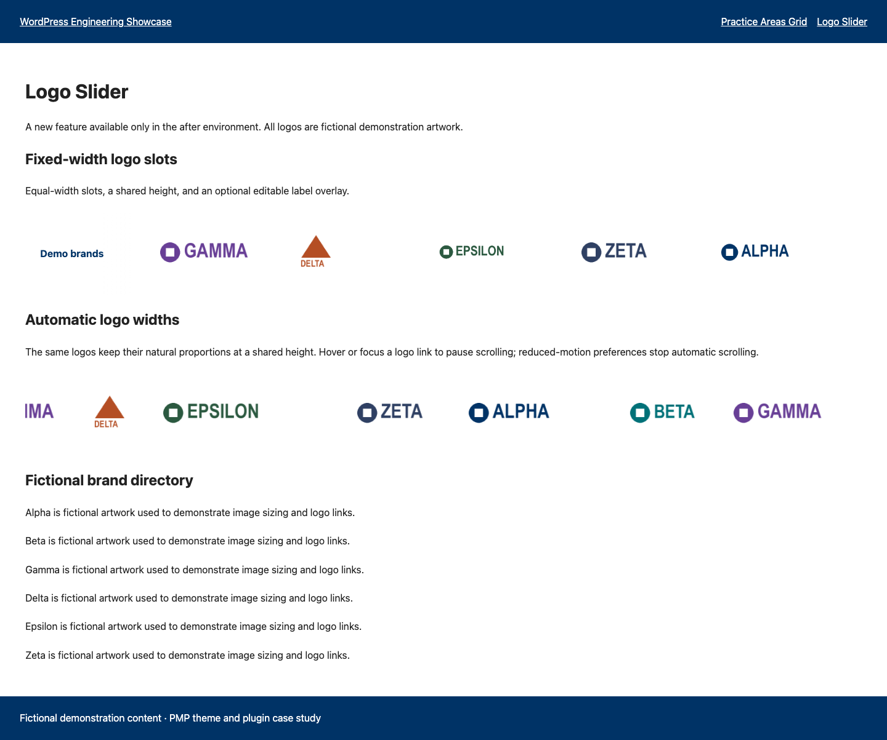
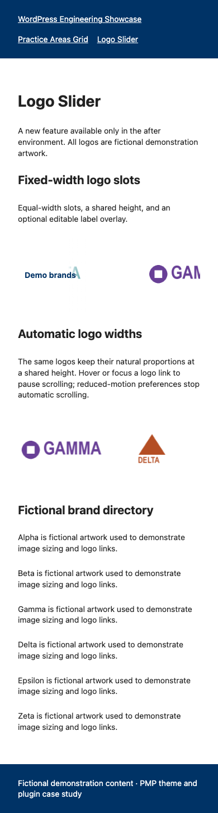

# Logo Slider

[Back to the feature index](../../README.md#features)

**Type:** New feature · **Demo availability:** After only · [Open the demo](http://localhost:8890/logo-slider/)

Developed by Wilbert Caba for the PMP theme. This example adds a reusable logo slider rather than extending an existing 10up block, so it does not need a before comparison.

## Business need

Let editors build a continuously scrolling row of logos without duplicating template markup or writing CSS for each page. Logos with different proportions should fit a shared height, and editors should be able to control spacing, speed, image sizing, and an optional label.

## My contribution

- Created **Logo Slider** (`pmp/logo-slider`) and its optional **Logo Slider Label** child block.
- Used ordinary Image blocks so editors retain WordPress image selection, alternative text, links, and ordering controls.
- Added fixed-width slots and automatic widths based on each image’s proportions.
- Added editor controls for scroll speed, logo dimensions, and spacing.
- Integrated Splide and its Auto Scroll extension, with hover/focus pausing, free dragging, and reduced-motion behavior.
- Kept the editor static so logos and the label remain easy to select and edit.

Splide provides the carousel engine; my code implements the Gutenberg blocks, server rendering, configuration, initialization, and motion-preference handling.

## Try the feature

Follow the [shared setup instructions](../../README.md#running-the-demos), then open [the Logo Slider page](http://localhost:8890/logo-slider/) in the after environment. The Grid remains the home page; the after site’s header links to both features.

The page contains two examples using the same six fictional logos:

1. **Fixed-width logo slots:** equal-width slots, a shared height, and an editable label overlay.
2. **Automatic logo widths:** each logo keeps its proportions at the chosen height, without a label.

Hover a slider or focus a logo link to pause it. Drag to move the row manually. With your operating system’s reduced-motion preference enabled, automatic scrolling stops and dragging remains available. Changing the preference while the page is open updates the behavior. The original implementation has no separate play/pause button.

Logo links go to fictional brand descriptions on the same page. They do not link to client sites or third-party brands.

### Add this example to an existing demo installation

Build the after theme and seed only this feature:

```sh
npm --prefix themes/pmp-theme ci
npm run build
SHOWCASE_RUNTIME=php npm run demo:seed:logo-slider
```

For Docker, use `npm run demo:seed:logo-slider` without the PHP prefix. For a disposable Local after site, run `wp eval-file /absolute/path/to/wordpress-engineering-showcase/scripts/seed-logo-slider.php` in its Site Shell.

The feature-specific seed command creates or restores the Logo Slider page and its six attachments. It preserves the Grid page, Grid edits, and home-page settings. Re-running it overwrites edits to the Logo Slider demo page, without creating duplicate pages or attachments. A fresh `demo:setup` or full `demo:seed` also includes this page in the after environment.

### Edit the slider

In the after site’s WordPress dashboard, open **Pages → Logo Slider**. Select a Logo Slider block in List View to access its settings. Add, replace, remove, or reorder Image blocks using the normal block editor controls.

| Setting | What it changes |
| --- | --- |
| Scroll speed | Automatic movement speed, from 0.1 to 5. |
| Automatic logo width | Uses each image’s proportions and the shared height. Hides the fixed-width control without discarding its saved value. |
| Logo width | Fixed slot width, from 80 to 400px; used when automatic width is off. |
| Logo height | Shared image height, from 24 to 160px. |
| Gap between logos | Space between slides, from 0 to 160px. |

Add one **Logo Slider Label** inside a slider for an overlay. Edit its text on the canvas and its colors, gradient, font size, and padding in Styles. The label stays in the normal layout in the editor; the frontend positions it over the left edge of the row. The fixed-width example uses a showcase CSS class to give its label a fading white background.

Save the page and reload the frontend to see changes. In automatic-width mode, dimensions and aspect ratios saved on individual Image blocks are overridden so the shared height stays consistent. Transparent padding inside an image still counts toward its intrinsic proportions.

## Implementation

The dynamic parent block saves its Image and Label inner blocks. PHP renders the images as Splide slides and retains the first label. Numeric settings are clamped on the server and passed through CSS custom properties and a data attribute.

The frontend initializer waits for image decoding in automatic-width mode before measuring the row, then mounts Splide with Auto Scroll. It calculates enough clones for continuous scrolling, preserves WordPress wrapper styles during refresh, and responds to changes in `prefers-reduced-motion`.

The showcase loads this initializer through the block’s `viewScript` metadata, rather than the original theme’s application-wide frontend bundle. This keeps the slider script tied to pages that render the feature. A compatibility fix also removes WordPress’s `sizes="auto"` keyword when those images are switched to eager loading; otherwise intrinsic-size containment can force a logo to 3000px wide. Other extracted source files are preserved from the private implementation; source revisions and file hashes are recorded under `logo-slider` in the [provenance manifest](../provenance.json).

| Area | Code entry point |
| --- | --- |
| Settings and allowed child blocks | [logo-slider/edit.js](../../themes/pmp-theme/includes/blocks/logo-slider/edit.js) |
| Block attributes and assets | [logo-slider/block.json](../../themes/pmp-theme/includes/blocks/logo-slider/block.json) |
| Server rendering and bounds | [logo-slider/markup.php](../../themes/pmp-theme/includes/blocks/logo-slider/markup.php) |
| Carousel and motion behavior | [frontend initializer](../../themes/pmp-theme/assets/js/frontend/components/logo-slider.js) |
| Label editing | [logo-slider-label/edit.js](../../themes/pmp-theme/includes/blocks/logo-slider-label/edit.js) |
| Frontend styles | [logo-slider/style.css](../../themes/pmp-theme/includes/blocks/logo-slider/style.css) |
| Isolated feature fixtures | [seed-logo-slider.php](../../scripts/seed-logo-slider.php) |

## Screenshots





## Verification

The feature’s [WordPress integration checks](../../tests/logo-slider-integration.php) cover registration, fixture counts, both width modes, label handling, image alternative text and links, and server-side numeric bounds. The [browser tests](../../tests/browser/logo-slider.spec.mjs) cover frontend mounting, image proportions, responsive layouts, motion preferences, hover/focus pausing, the static fallback, after-only availability, editor validity, and saved settings.

Run `SHOWCASE_RUNTIME=php npm run demo:check` for PHP integration checks, or `npm run demo:check` for Docker. Run `npm run test:browser -- --grep 'logo slider:'` with the demo sites running for browser checks.

The six logo PNGs are fictional artwork created for the showcase, not client assets. They are included in Git; regenerating them is optional and uses [the fixture generator](../../scripts/generate-logo-fixtures.php), which requires PHP GD and accepts a local TrueType font path.
