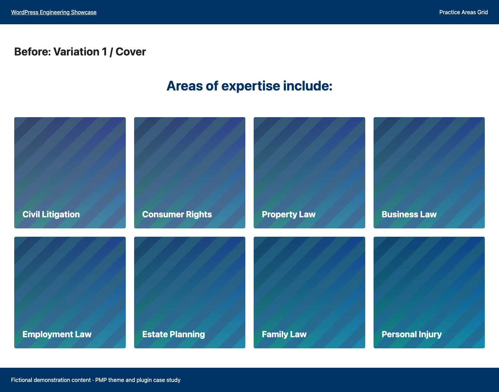
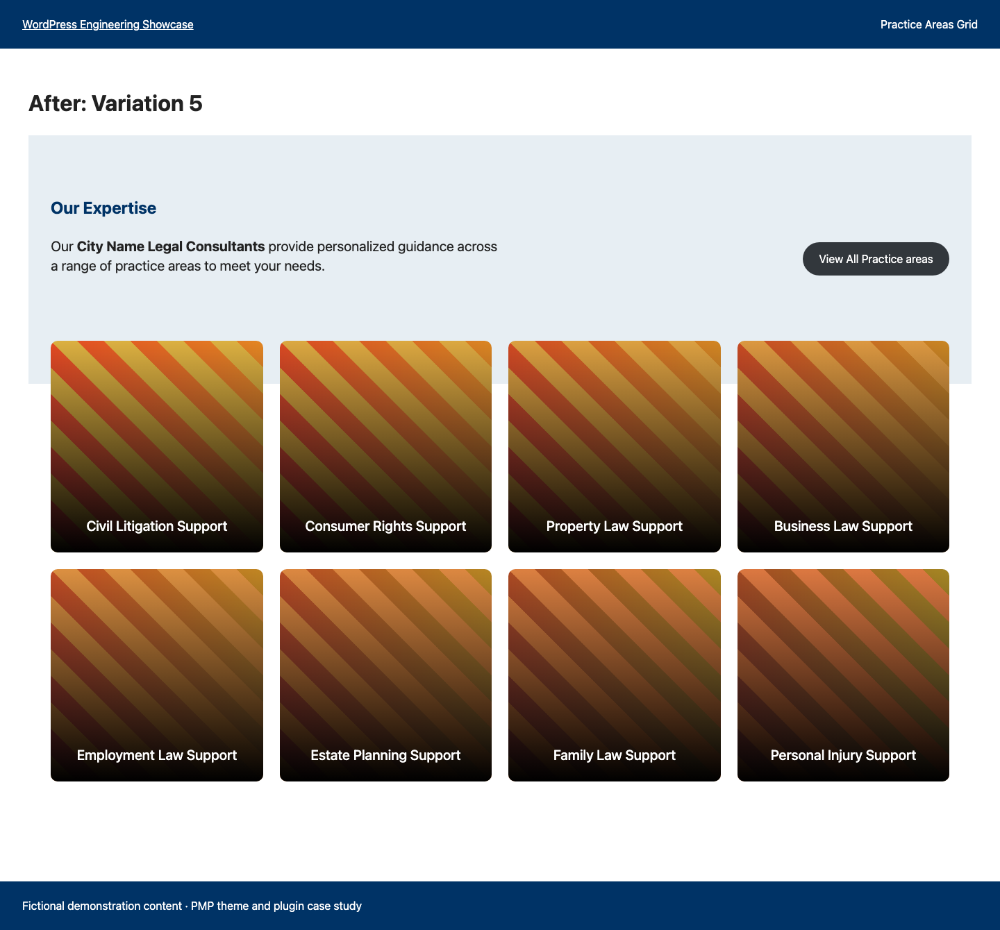
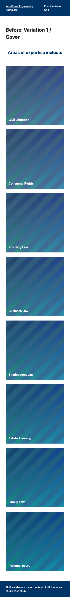
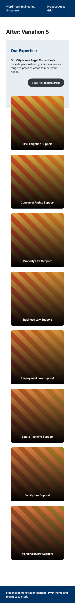

# Extending the Practice Areas Grid

## The original component

The original theme already supplied Practice Areas Grid patterns, a Query Loop extension named Content Card, multiple card layouts, alternative titles, and metadata rendering. Those foundations are existing team code, not presented as newly authored for this case study.

The before example inserts **Variation 1** and selects **Display Settings → Variation → Cover**. It displays a practice area's featured image with an overlaid title. The feature baseline is the theme revision immediately preceding `ee2c9c56` and the plugin revision immediately preceding `fea404a`.

## The extension

Wilbert Caba's September 24–30, 2025 changes introduced a separate image for practice-area cards and composed those capabilities into Variation 5:

1. Register `card_image` as an integer attachment ID in the plugin content model; sanitize it with `absint`.
2. Add a document sidebar media picker and a Show Card Image toggle in the Query Loop's Display Settings.
3. Extend the `pmp/post-meta` block to render an attachment image and the card template to prefer that image when enabled.
4. Preserve title metadata while filtering image blocks recursively.
5. Add Variation 5's hero, overlapping responsive grid, independent card images, and dynamic secondary titles.

`title_secondary` and `card_image` flow from WordPress post metadata through the REST API to the editor. Query Loop context identifies the practice-area post rendered by each card. The PHP renderer uses `wp_get_attachment_image`, while the dynamic heading reads that post's secondary title.

The base post-type class already defaulted registered metadata to `show_in_rest: true` and `single: true`. The September 30 plugin change made those declarations explicit; it did not introduce REST support from scratch.

## Reviewing the code

Start with the [original feature extraction diff](https://github.com/wilbertcaba/wordpress-engineering-showcase/compare/practice-areas-grid-before...practice-areas-grid-extracted), then review the [verified before/after comparison](https://github.com/wilbertcaba/wordpress-engineering-showcase/compare/practice-areas-grid-before...practice-areas-grid-after). Tags and links become available on GitHub after the reviewed local history is published.

The showcase has a fresh baseline commit followed by separate commits for metadata/editor controls, content-card behavior, and Variation 5 styling. These are curated extraction commits, not the original private Git history. `docs/provenance.json` maps source files and revisions and records adaptations.

The theme range contains eleven relevant commits. The unrelated duplicate contact-pattern removal (`94c2ac82`) is excluded. The plugin companions are `fea404a` and `ea8d4d9`.

## Try the functionality

1. Start both sites using the root README or the Local instructions.
2. Open the before site: Variation 1 / Cover uses the blue featured-image fixtures and original titles.
3. Open the after site: Variation 5 uses orange card-image fixtures and secondary titles, with the original pattern's per-page limit of ten. Eight fixture posts keep the comparison manageable.
4. In the after site's editor, open a Practice Area, expand Card Image, and select, replace, or remove an image. Save and reload.
5. Edit the after demo page, select its Content Card Query Loop in List View, and use Show Card Image / Show Featured Image. Save and inspect the frontend.
6. Compare desktop and mobile layouts. Card links open local fictional practice-area details.
7. Re-run `npm run demo:seed` to restore the demo records after experimenting.

The before runtime runs the tagged pre-extension extraction, with its own database/uploads. It does not simulate the old editor using the extended code. Both states use focused bootstrap adapters and system fonts, so this is a historical feature demonstration rather than a pixel-identical copy of a client site.

| Before: Variation 1 / Cover | After: Variation 5 |
| --- | --- |
|  |  |
|  |  |

## Showcase adaptations and corrections

The demo removes unrelated post types, shadow-taxonomy integrations, navigation, forms, premium plugins, client assets and production deployment configuration. The grid-only wrapper replaces the broader Content Display editor UI. An explicit MU loader and block bootstrap replace application-wide module discovery. The original Query renderer's card-class filter is retained as a standalone function.

A separate correction commit addresses issues exposed while making the after state independently runnable:

- Scope the document card-image panel to Practice Areas and use integer zero when clearing an attachment.
- Keep an explicitly configured text-meta block from being converted into an image block.
- Resolve dynamic heading previews per queried post without writing competing values into shared template attributes.
- Apply image visibility changes atomically, preserving non-image child blocks and permitting Advanced Heading children.
- Load the extracted editor stylesheet and remove debug logging and a duplicate metadata description.
- Render missing attachments without exposing a raw attachment ID.

These fixes are described separately from the original extension. Corrected editor files are formatted consistently, and build dependency patches/lint configuration are tracked separately from the feature commits. The before tag retains the historical feature logic. No production database migrations, credentials, or private package installation are required.
