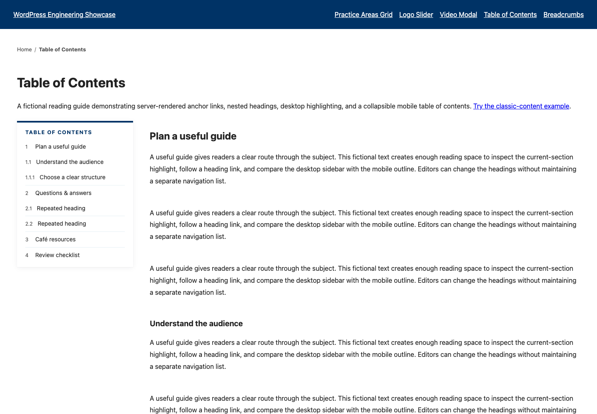
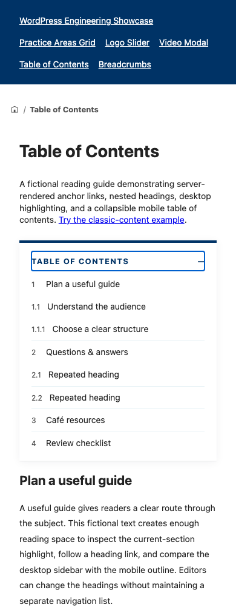

# Table of Contents

[Back to the feature index](../../README.md#features)

**Type:** New in-house feature · **Demo availability:** After only · [Open the demo](http://localhost:8890/table-of-contents/)

This feature began in-house at PMP, with an initial block and an early back-to-top enhancement by contributor **dbeqiri1396**. **Wilbert Caba** later reworked and extended it into the current implementation. It was not an extension of a 10up Table of Contents component. This single guide covers that evolution and the current feature; there is no separate before environment for it.

## Business need

Long articles need an outline that readers can use without editors maintaining a second list of links. The feature must work in desktop sidebars and mobile article content, remain consistent with site styles, and support older articles that still use classic HTML.

## From inception to the current feature

| Stage | Contribution | Result |
| --- | --- | --- |
| Initial in-house implementation — dbeqiri1396 | Created the heading-level controls and dynamic outline. | A reusable block lists headings from the current post. |
| Early enhancement — dbeqiri1396 | Added browser-generated heading IDs and back-to-top links. | Readers could navigate back to the outline from article sections. |
| Rework — Wilbert Caba | Rebuilt the editor preview and Styles controls; added responsive placement, desktop stickiness, scroll highlighting, and shared defaults. | The same block serves desktop sidebars and mobile content, with site-wide styling and per-instance overrides. |
| Content and editor reliability — Wilbert Caba | Added per-side padding, corrected spacing defaults and an editor crash, and aligned anchors between renderers. | Better editor behavior and more consistent output. |
| Legacy content — Wilbert Caba | Added classic/Custom HTML heading discovery, server-generated IDs, and optional automatic mobile insertion. | Older content gains a working outline without conversion to heading blocks. |
| Current presentation — Wilbert Caba | Added collapsible mode, Numbered/Rail/Highlight styles, a heading filter, and nested-sticky handling. | More presentation choices and safer sidebar composition. |

The current implementation replaces the early browser-only enhancer. It does **not** retain the old automatic back-to-top links. Original source revisions and authorship are recorded in the [provenance manifest](../provenance.json); private repository access is not needed to inspect or run the extracted code here.

## Try the feature

Follow the [shared setup instructions](../../README.md#running-the-demos), then open:

- [Block-content guide](http://localhost:8890/table-of-contents/): eight headings across H2–H4, duplicate titles, an accented title, and an explicit anchor. A sticky Numbered outline appears beside the article on desktop; a collapsible copy appears inside it on mobile.
- [Classic-content guide](http://localhost:8890/table-of-contents-classic/): a Rail outline of raw HTML headings, including a repeated title and preserved manual ID.

Scroll the desktop guide to see the active section change. Click an outline link and inspect its matching heading ID. At widths below 782px, open the mobile outline with Enter or Space and follow a link. The links and IDs are in the server HTML and remain available without JavaScript; highlighting and nested-sticky detection are frontend enhancements.

The guides are fictional. Seeding does not enable automatic insertion or alter shared styles site-wide.

### Add this example to an existing installation

```sh
npm --prefix themes/pmp-theme ci
npm run build
SHOWCASE_RUNTIME=php npm run demo:seed:toc
```

For Docker, use `npm run demo:seed:toc` without the PHP prefix. In a disposable Local after site’s Site Shell, run `wp eval-file /absolute/path/to/wordpress-engineering-showcase/scripts/seed-toc.php`.

The feature-only command creates or restores the two owned guide pages, preserving other feature records, shared style settings, and the home-page setting. Re-running overwrites edits to those guide pages without creating duplicates. Full setup and seeding also include the guides in the after environment.

## Edit and review

Open **Pages → Table of Contents** in the after dashboard. Select either Table of Contents block in List View. Both instances remain visible in the editor so they can be edited regardless of their frontend placement.

| Control | Behavior |
| --- | --- |
| Title | Inline text, visibility, and title tag H2–H6 or paragraph. |
| Show on | Always, desktop only (782px and up), or mobile only. |
| Sticky on desktop | Keeps the desktop outline in view; optional top offset. |
| Highlight current section | Desktop scrollspy with `aria-current="location"`. |
| Collapsible | Native `details`/`summary`, initially closed; ignored when the instance is sticky. |
| Include Heading Levels | Includes H2 through H6 independently; H2 is on by default. |
| Styles | Default, Numbered, Rail, or Highlight, plus standard block colors, typography, spacing, and borders. Numbered follows the outline hierarchy: `1`, `1.1`, `1.1.1`, then `2`. |
| List Items | Item spacing, per-side padding/borders, radius, background, and active colors. |
| Scroll Offset | Overrides scroll margin for heading targets; the first explicit offset on a page wins. |

Change a heading, toggle included levels, save, reload, and compare the editor outline with the frontend. Repeated titles receive suffixes; explicit anchors remain intact. With no matching headings the frontend omits the outline, while the editor shows a styling placeholder.

### Shared styles

Administrators can open **Styles → Site-wide Defaults → Apply to all Table of Contents blocks**. List-item attributes are saved in `pmp_toc_item_defaults`; block-level styles are merged into WordPress Global Styles. The instance overrides are cleared so it follows those shared values. Explicit instance values still win, including an item gap of `0`.

**Clear shared list item styles** clears the list-item option only. It leaves Global Styles intact; reset those separately in the Site Editor. Sticky, placement, and scrollspy remain per-instance controls. Editors without permission to manage options can inherit the styles but cannot save site-wide settings.

### Automatic mobile insertion

Off by default. **Settings → General → Table of Contents** enables inserting a mobile outline before the first heading of singular main-query content that has no explicit TOC block. Both block content and classic HTML are supported. Turning it off stops automatic insertion; stored article content is not rewritten. The showcase keeps this option off to avoid changing the other demos.

## Data flow and engineering choices

1. PHP reads the current post, recursively collects heading blocks and plain headings in classic/Custom HTML, and resolves explicit or generated anchors before filtering by included level.
2. A shared helper builds a nested list. Skipped heading levels nest one step; a leading H3 can be a root. The block title is excluded from the heading-ID pass.
3. A `the_content` filter adds missing IDs after blocks and shortcodes render. Links and IDs therefore exist before frontend JavaScript runs.
4. The editor mirrors discovery, slugging, nesting, and style fallbacks. Shared defaults use the authenticated WordPress settings endpoint.
5. Desktop JavaScript selects the last heading above a reading line, updates the current link and ancestor items, and keeps the active link visible in an overflowing outline. It suspends highlighting while a clicked anchor scrolls into place and disables it below the breakpoint.

Server rendering makes navigation usable without script execution. Two responsive copies allow different placement, at the cost of rendering two lists; CSS hides the inactive copy. Sticky behavior depends on its container’s height and overflow. An outline inside an already sticky/fixed ancestor disables its own stickiness to avoid competing layouts.

Generated IDs are stable for unchanged text and ordering. Renaming or reordering unsaved classic headings can change their IDs. Authors who need permanent external links should set explicit anchors. Outline discovery reads stored article content: headings produced only by shortcodes or other dynamic blocks are not automatically listed, even though the content filter can assign them IDs. The `pmp_theme_toc_headings` filter supports custom integration.

## Source and showcase adaptations

The original block names, attributes, option names, and hooks are retained. The showcase explicitly loads the original module base and TOC helper instead of the private application’s autoloader. Only the TOC General Settings field is extracted from the larger settings module, and only its theme defaults and required tokens are included.

Compatibility/correctness changes made for this showcase are separate from the historical contribution:

- A batched editor anchor pass replaces core’s eager automatic generation. Testing on the earlier WordPress 6.8 runtime showed that repeated headings mounted together could otherwise receive duplicate IDs; the fix is retained and verified on WordPress 7.0.9. Missing heading anchors are assigned in one pass; explicit anchors are preserved.
- The Numbered style uses hierarchical counters for nested entries in both the editor and frontend. Numbering follows the outline depth, including skipped heading levels.
- Color serialization rejects declaration delimiters so one color cannot introduce additional CSS declarations.
- The extracted media-query tokens define desktop at 782px and use a nonoverlapping mobile maximum. One source indentation issue was corrected for lint.
- Fictional pages, their layout CSS, navigation, tests, and screenshots are showcase additions. The wider private templates and unrelated sticky/header infrastructure are not imported.

| Area | Code entry point |
| --- | --- |
| Attributes and styles | [block.json](../../themes/pmp-theme/includes/blocks/toc-block/block.json) |
| Editor controls and preview | [edit.js](../../themes/pmp-theme/includes/blocks/toc-block/edit.js) |
| Shared style persistence | [site-defaults.js](../../themes/pmp-theme/includes/blocks/toc-block/site-defaults.js) |
| Server discovery, IDs, defaults and insertion | [TocBlock.php](../../themes/pmp-theme/includes/classes/Block/TocBlock.php) |
| Dynamic markup | [markup.php](../../themes/pmp-theme/includes/blocks/toc-block/markup.php) |
| Scrollspy and nested sticky detection | [view.js](../../themes/pmp-theme/includes/blocks/toc-block/view.js) |
| Batched anchor compatibility fix | [editor-toc-anchors.js](../../themes/pmp-theme/assets/js/editor-toc-anchors.js) |
| Demo pages | [seed-toc.php](../../scripts/seed-toc.php) |

## Screenshots





## Verification

[Unit tests](../../tests/toc.test.mjs) cover slugging, duplicate/reserved IDs, nesting, per-side spacing, and batched editor generation. [WordPress checks](../../tests/toc-integration.php) cover classic anchors, rendering agreement, escaping, CSS validation, shared-default inheritance and permissions, and automatic insertion for block/classic content. [Browser tests](../../tests/browser/toc.spec.mjs) exercise responsive placement, scroll highlighting, sticky behavior, keyboard expansion, static links, editor persistence, and shared-style controls.

Run `SHOWCASE_RUNTIME=php npm run demo:check` for PHP integration checks, or omit the prefix for Docker. With both sites running, use `npm run test:browser -- --grep 'toc:'` for this feature’s browser checks. See the shared [verification record](../verification.md) for tested versions and runtime limitations.
