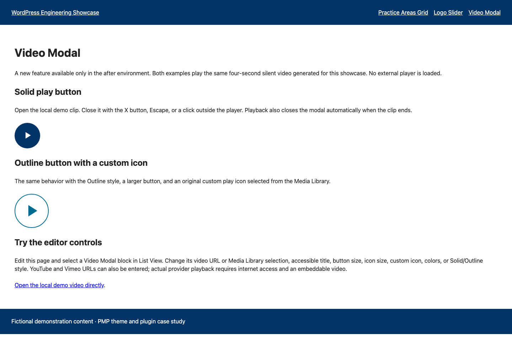
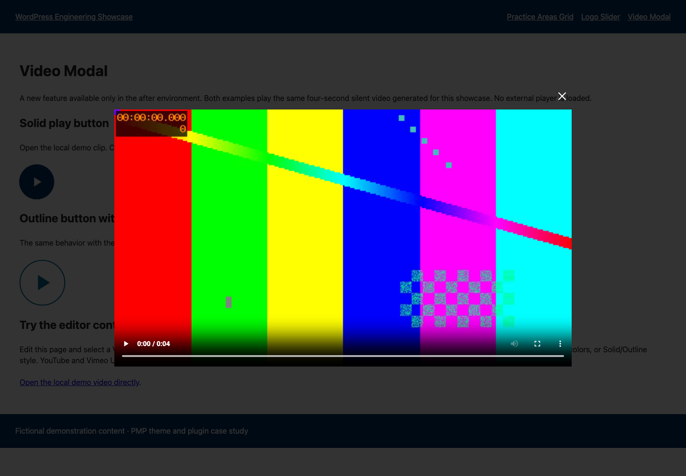
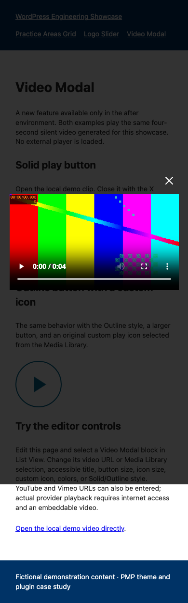

# Video Modal

[Back to the feature index](../../README.md#features)

**Type:** New feature · **Demo availability:** After only · [Open the demo](http://localhost:8890/video-modal/)

Developed by Wilbert Caba for the PMP theme. This example adds a reusable video trigger and dialog, so it does not need a before comparison.

## Business need

Let editors place a round play button alongside page content and open a video without sending visitors to a separate page. Editors can use a Media Library video, YouTube, or Vimeo, with control over the button’s appearance and accessible title.

## My contribution

- Created the dynamic **Video Modal** block (`pmp/video-modal`), its editor controls, server rendering, styles, and frontend behavior.
- Added solid and outline styles, adjustable button and icon sizes, and a custom image icon.
- Used the browser’s native `dialog` element for modal focus management and Escape dismissal.
- Created the player only when the button is activated, and removed it when the dialog closes.
- Implemented provider URL parsing, YouTube/Vimeo message handling, and automatic dismissal at the end of playback.

## Try the feature

Follow the [shared setup instructions](../../README.md#running-the-demos), then open [Video Modal](http://localhost:8890/video-modal/) in the after environment. The header links to each feature; the Grid remains the home page.

The page contains a solid button with the default play icon and an outline button with a custom image icon. Both play the bundled four-second silent test clip. No external video service is needed for this demo.

Activate either button, then close the dialog with its close button, Escape, or the backdrop. Let the clip finish to see automatic dismissal. Keyboard users can reach the trigger with Tab; focus returns to it after dismissal.

### Add this example to an existing demo installation

```sh
npm --prefix themes/pmp-theme ci
npm run build
SHOWCASE_RUNTIME=php npm run demo:seed:video-modal
```

For Docker, use `npm run demo:seed:video-modal` without the PHP prefix. For a disposable Local after site, run `wp eval-file /absolute/path/to/wordpress-engineering-showcase/scripts/seed-video-modal.php` in its Site Shell.

This command creates or restores only the Video Modal page and its two attachments. It preserves the Grid and Logo Slider pages and home-page settings. Re-running overwrites edits to the Video Modal demo records without creating duplicates. Full setup and seeding also include this example in the after environment.

### Edit the block

Open **Pages → Video Modal** in the after dashboard. Select a Video Modal block in List View and open its block settings.

| Setting | What it changes |
| --- | --- |
| Video URL | A YouTube, Vimeo, or direct video-file URL. |
| Select from Media Library | Sets the URL to a selected video attachment. |
| Video title | Describes the trigger and player for screen-reader users. |
| Button size | Diameter from 40 to 200px. |
| Icon size | Icon width from 20% to 90% of the button. |
| Custom icon from Media Library | Replaces the default play symbol with an image. Reset to play icon restores the default. |

Use Styles to choose solid or outline and adjust supported colors and borders. Save, reload the editor, and open the frontend to verify the result. Playback is available on the frontend; the editor displays the trigger preview.

YouTube watch links, short links, shorts, live, and embed URLs are recognized. Vimeo numeric URLs and private-link hashes are supported. Direct-file URLs must end in a supported video extension, optionally followed by a query string; actual playback depends on the browser’s codec support. Hosted providers require internet access and a video that permits embedding. Unsupported URLs do not initialize a player; an empty URL produces no frontend block.

## Implementation

The block stores its settings in block attributes. PHP escapes the URL and title and renders a button, a named dialog, and an empty player container. The block’s `viewScript` initializes only rendered instances. Activation creates a native video element or constructs a trusted provider embed URL from the parsed ID.

YouTube and Vimeo messages are accepted only from the expected origin and the active iframe window. Dismissal removes message listeners and the player, explicitly pauses/unloads native media, and restores the body’s prior overflow value.

The showcase preserves the original interfaces and records source revisions, authorship, and file hashes in the [provenance manifest](../provenance.json). Showcase corrections are identified there: stricter URL/provider validation, preservation of Vimeo privacy hashes, restoration of the previous scroll style, explicit native-media cleanup, and the current Vimeo `ended` event subscription. The listener also accepts the historical `finish` event. The current event name is documented by the [Vimeo Player SDK](https://github.com/vimeo/player.js/).

| Area | Code entry point |
| --- | --- |
| Attributes and asset registration | [block.json](../../themes/pmp-theme/includes/blocks/video-modal/block.json) |
| Editor settings and media selection | [edit.js](../../themes/pmp-theme/includes/blocks/video-modal/edit.js) |
| Escaped server markup | [markup.php](../../themes/pmp-theme/includes/blocks/video-modal/markup.php) |
| Players and dialog lifecycle | [view.js](../../themes/pmp-theme/includes/blocks/video-modal/view.js) |
| Responsive styles | [style.css](../../themes/pmp-theme/includes/blocks/video-modal/style.css) |
| Isolated demo content | [seed-video-modal.php](../../scripts/seed-video-modal.php) |

## Screenshots







## Verification

[Unit tests](../../tests/video-modal.test.mjs) cover provider parsing, privacy hashes, unsafe inputs, and message validation. [WordPress checks](../../tests/video-modal-integration.php) cover registration, fixtures, both instances, rendering, title escaping, and lazy player markup. [Browser tests](../../tests/browser/video-modal.spec.mjs) cover real local playback, responsive layout, keyboard/focus behavior, dismissal, cleanup, independent instances, editor media selection, and saved settings.

Provider tests use controlled iframe responses to verify the YouTube/Vimeo message contracts; they do not establish live third-party playback compatibility. The local clip is played by Chromium during the tests.

Run `SHOWCASE_RUNTIME=php npm run demo:check` for PHP integration checks, or omit the prefix for Docker. With both sites running, use `npm run test:browser -- --grep 'video modal:'` for this feature’s browser checks.

The clip and PNG icon are original procedural fixtures, included in Git. Optional regeneration uses [generate-video-fixtures.mjs](../../scripts/generate-video-fixtures.mjs) and requires ffmpeg; running the demo does not require it.
